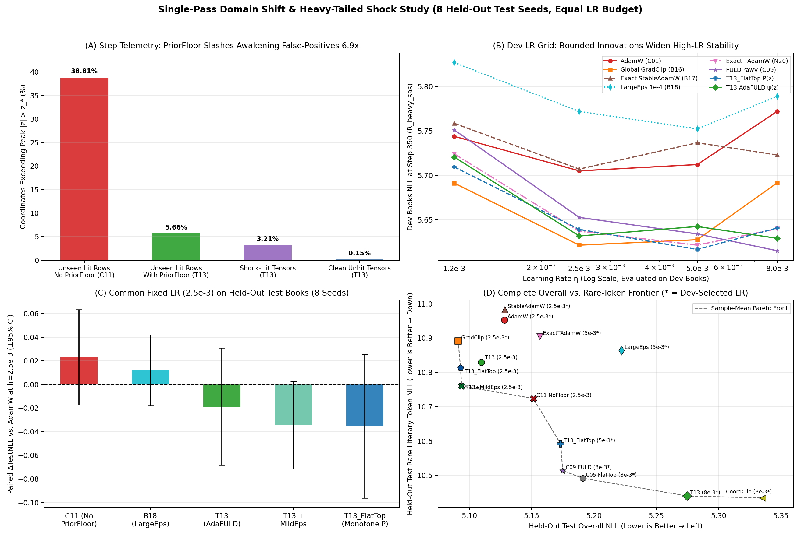

# LLM-Spike-FULD-Study — 单遍异构域切换下的 Loss 尖峰机理与分数阶回落消融研究

围绕 **Transformer 单遍（1-pass）异构数据流预训练中的 Loss 尖峰（Loss Spikes）成因**，对“将 ICML 2020 分数阶欠阻尼 Langevin 动力学（FULD, Şimşekli et al.）重尾回落思想移植进 AdamW”这一假说开展的**机制建模、正交消融实验与严格负结果证伪研究**（姊妹算子工程仓库：[GTilor/fuld-cuda](https://github.com/GTilor/fuld-cuda)）。



---

## 核心科学问题与结论速览（Executive Summary）

本研究从两个递进问题出发，在 `12.66M` 参数 Pre-LN GPT 模型、`Python 源码 → DeepMind PG-19 经典文学` 严格单遍无重复流（按文件/书目切分独立 `Train / Dev / Held-Out Test`）及受控局部冲击日程上，完成了 **10+ 种优化器机制 × 同等 4 档学习率调参预算 × 8 组独立测试种子（共 384 条测试评估轨迹）** 的对照检验：

| 待检验科学假说 | 实验与理论裁决 | 核心定量证据 |
|---|---|---|
| **1. 单遍跨域切换的尖峰主因是“梯度自身幂律厚尾”还是“休眠预条件器失配”？** | **休眠预条件器失配（成立）** | 代码阶段结束后 `33.0%` 的活跃文学词此前零出现（`v_t = 0`）；切入文学瞬间，词嵌入全张量预条件放大比 $P_{99.9}(|g|/\sqrt{\hat{v}})$ 暴增 **`569×`**（`76.89 → 43,781`），而四分位归一化梯度残差尾比并未增厚（`7.70 → 7.16`）。 |
| **2. 直接将有界/回落核用于新息是否会误伤新域特征？先验尺度托底能否解救？** | **存在“唤醒陷阱”，先验托底有效解救（成立，[命题 2B](docs/theory_proofs.md)）** | 无先验下界的回落核 `C11` 需至少 `24` 次（精确递推 `94–95` 次）非零出现才能脱离二阶门控，前 25 步未见文学词越峰误杀率达 **`38.81%`**；开启同层均方根先验托底 `T13`（$\rho_{\text{prior}}=0.15$）后误杀率降至 **`5.66%`（降低 `6.86×`）**，共同固定 `lr=2.5e-3` 下显著改善总体测试 NLL（`-0.0417`, Holm 校正 $p=0.0264$）。 |
| **3. FULD 标志性的“过峰回落（$\psi_\alpha(z) \to 0$）”是否比单调平顶饱和更有优势？** | **未观察到额外总体收益（被证伪）** | 与峰前 $|z|\le z_*$ 逐位完全恒等的单调平顶双胞胎 `T13_FlatTop` 相比，`T13` 在共同最优学习率 `2.5e-3` 下差值为 `+0.0165 NLL`（95% CI `[-0.0080, +0.0411]`, $p=0.155$），过峰回落未带来净改善。 |
| **4. 在同等学习率调参预算下，改造后的 `AdaFULD-W (T13)` 能否全面击败标准基线？** | **不能击败调好 LR 的 `GradClip`（被证伪）** | 当全部 10 种方法均在 `Dev` 书目上独立搜索 4 档学习率 `{1.2e-3, 2.5e-3, 5e-3, 8e-3}` 时，零额外开销的 **`AdamW + Global GradClip(1.0)`（选出 `2.5e-3`）以 `5.0910 ± 0.0309` 取得全场最低总体测试 NLL**，优于高学习率稳定但开发集选参偏激进的 `T13@8e-3` (`5.2746`)。 |
| **5. 新息饱和 + 先验尺度托底在什么细分边界内仍有保留价值？** | **高学习率稳定域 & 总体—长尾词权衡（局部温和效用）** | 在高学习率 `lr >= 5e-3` 下有界新息大幅抑制发散；在共同 `lr=2.5e-3` 下，`T13_FlatTop` (`5.0930`) 与 `T13+MildEps` (`5.0938`) 总体测试 NLL 追平最优 `GradClip` (`5.0910`)，同时在罕见文学词与代码零频词上领先约 `0.08 ~ 0.13 NLL`。 |

> **关键归因透明说明**：
> 1. **`UNK` 桶集中效应**：本基准使用 `8,192` 训练集 BPE 子词词表（测试集词表外子词映射至 `UNK_ID=8191`，占文学测试目标的 `10.51%`）。拆解固定 `lr=2.5e-3` 下 `T13` 相对 `C11` 的总体改善（全体 `-0.04174` vs. 已知非 `UNK` 词 `-0.00459`）可知，至少约 **89%** 的总体净改善来自高频 `UNK` 超级 token，而非具名罕见词桶。
> 2. **硬件吞吐开销**：在 NVIDIA A10G 上，原生 `AdamW` 与 `GradClip` 分别为 `14.55 ms/step (281.6k tok/s)` 与 `14.91 ms/step`，而未融合的纯 PyTorch 版 `T13` 为 `34.49 ms/step (118.8k tok/s)`（慢 `2.37×`）。实际部署需移除无额外收益的过峰回落分支，并编写类似 [fuld-cuda](https://github.com/GTilor/fuld-cuda) 的融合 Triton/CUDA 算子。

---

## 核心实测数据（NVIDIA A10G，8 组独立测试种子 `[101..808]`）

### 1. 逐步机理遥测与 A10G 吞吐基准

| 遥测 / 性能指标 | 实测数值 | 说明 |
|---|---:|---|
| 代码期零频文学词行越峰率（无先验托底 `C11`, 切入后前 25 步） | **`38.81%`** | 近四成真实新域词坐标落入 $|z|>z_*$ 压制区（唤醒陷阱） |
| 代码期零频文学词行越峰率（加先验托底 `T13`, 切入后前 25 步） | **`5.658%`** | 开启 $\rho_{\text{prior}}=0.15$ 后误杀率降低 **`6.86×`** |
| 重尾冲击命中张量 vs. 未命中干净张量平均越峰率（`T13`） | **`3.207%` vs. `0.1542%`** | 命中张量截断密度高出 **`20.8×`**，具备张量级局部选择性 |
| 单步训练耗时：`AdamW` / `GradClip` / `ExactStableAdamW` / `ExactTAdamW` / `T13` | `14.55` / `14.91` / `17.10` / `17.27` / `34.49` ms | `B=32, T=128`（`4,096 tok/step`，BF16 混合精度） |

### 2. 同等 4 档学习率调参预算下的独立测试书目对比（`R_heavy_sas`）

全部 10 种方法先在独立 `Dev` 书目（种子 `[11, 22]`）上从 `{1.2e-3, 2.5e-3, 5.0e-3, 8.0e-3}` 选出各自最优学习率 $\eta^*$，随后在从未参与训练和选参的 16 本 `Held-Out Test` 书目（`131,072` 目标 token × 8 个全新种子）上评估：

| 方法 | Dev 选出 $\eta^*$ | 测试全体 NLL $\downarrow$ | 已知非 UNK NLL $\downarrow$ | 罕见文学词 NLL $\downarrow$ | 代码零频文学词 NLL $\downarrow$ |
|---|---:|---:|---:|---:|---:|
| **`B16_GradClip`（全局裁剪 1.0）** | `0.0025` | **`5.0910 ± 0.0309` (#1)** | **`5.4777`** | `10.8918` | `9.3287` |
| `C01_AdamW` | `0.0025` | `5.1283 ± 0.0468` | `5.5176` | `10.9524` | `9.4639` |
| `B17_StableAdamW_Exact`（Wortsman Alg. 2） | `0.0025` | `5.1284 ± 0.0351` | `5.5231` | `10.9825` | `9.4815` |
| `N20_ExactTAdamW`（Ilboudo Alg. 1） | `0.0050` | `5.1566 ± 0.0680` | `5.5736` | `10.9048` | `9.3561` |
| `T13_FlatTop`（峰前同构平顶） | `0.0050` | `5.1732 ± 0.0538` | `5.5519` | `10.5919` | `9.1728` |
| `C09_FULD_raw`（仅一阶回落） | `0.0080` | `5.1750 ± 0.0464` | `5.5298` | `10.5137` | `9.1272` |
| `C05_FlatTop_raw`（仅一阶平顶） | `0.0080` | `5.1911 ± 0.0372` | `5.5499` | `10.4915` | **`9.1004`** |
| `B18_LargeEps_1e-4` | `0.0050` | `5.2221 ± 0.1190` | `5.6161` | `10.8642` | `9.3834` |
| `T13_AdaFULD_PriorFloor` | `0.0080` | `5.2746 ± 0.0577` | `5.6428` | `10.4400` | `9.2482` |
| `N19_CoordClip`（逐坐标自适应裁剪） | `0.0080` | `5.3352 ± 0.0614` | `5.6951` | **`10.4340`** | `9.5614` |

*(注：在配对轻尾高斯冲击 `R_light_gauss` 调参组中，`N20_ExactTAdamW@0.0025` 以 `5.0987 ± 0.0442` 居首，`B16_GradClip@0.0025` 为 `5.1066`，`T13@0.0025` 为 `5.1187`；完整分工况数据见 [`results/exp_results_v3.json`](results/exp_results_v3.json)。)*

### 3. 共同固定学习率（`lr = 2.5e-3`）下的受控机制隔离

排除开发集 2 种子选参波动（`T13` 在 `Dev` 上 `0.0025` 与 `0.0080` 仅差 `0.0026 NLL`），将各消融臂统一固定在 `lr = 2.5e-3` 时的 8 种子独立测试结果：

| 方法（共同固定 `lr = 2.5e-3`） | `R_clean` 全体 / 非UNK | `R_light_gauss` 全体 | `R_heavy_sas` 全体 | `R_heavy_sas` 罕见词 | `R_heavy_sas` 代码零频词 |
|---|---:|---:|---:|---:|---:|
| `C01_AdamW` | `5.1211` / `5.5302` | `5.1352 ± 0.0543` | `5.1283 ± 0.0468` | `10.9524` | `9.4639` |
| `B18_LargeEps_1e-4` | **`5.1008`** / **`5.4994`** | `5.1188 ± 0.0475` | `5.1402 ± 0.0345` | `10.9525` | `9.3867` |
| `C11_FULD_cap_noFloor` | `5.1962` / `5.5586` | `5.1734 ± 0.0424` | `5.1513 ± 0.0322` | `10.7240` | `9.2656` |
| `T13_AdaFULD_PriorFloor` | `5.1220` / `5.5300` | `5.1187 ± 0.0509` | `5.1095 ± 0.0509` | `10.8294` | `9.3394` |
| **`T13_FlatTop`（单调平顶 + 先验托底）** | `5.1058` / `5.5114` | **`5.0951 ± 0.0531`** | **`5.0930 ± 0.0590`** | `10.8130` | **`9.2417`** |
| **`T13_Plus_MildEps`（$\epsilon = 2\times 10^{-5}$）** | `5.1132` / `5.5182` | `5.1054 ± 0.0389` | **`5.0938 ± 0.0414`** | **`10.7602`** | `9.2546` |

---

## 目录结构

```text
llm-spike-fuld-study/
├── adafuld/                         # 模块化自适应优化器与原论文基线精确实现
│   ├── __init__.py                  # 公开 API 导出
│   └── optimizers.py                # ModularAdaptiveAdamW, ExactTAdamW, ExactStableAdamW
├── experiments/
│   ├── modal_benchmark.py           # Modal A10G 完整三分数据集基准（遥测 + Dev 调参 + 8 种子测试）
│   └── plot_results.py              # 从 JSON 原始记录重绘四面板分析图与样本均值 Pareto 前沿
├── results/
│   └── exp_results_v3.json          # A10G 实机产出的 384 条测试记录、分位数与 Holm 统计检验完整数据
├── figures/
│   └── benchmark_overview.png       # 四面板评测与 Pareto 前沿总览图
├── docs/
│   └── theory_proofs.md             # 命题 1, 2A, 2B, 3B 与定理 4 的完整数学推导
└── tests/
    └── test_optimizers.py           # 有理核多项式界、零梯度保持、唤醒陷阱递推与基线不动点单元测试
```

---

## 快速开始

### 1. 安装与运行本地单元测试 / 重绘图表

```bash
pip install -e ".[dev]"

# 运行数学契约与优化器单元测试（CPU 即可秒级完成）
pytest -v tests/test_optimizers.py

# 从 results/exp_results_v3.json 直接重绘 figures/benchmark_overview.png
python3 experiments/plot_results.py
```

### 2. 在 Modal 云端 GPU 完整重跑 A10G 基准

```bash
pip install -e ".[modal]"
modal run experiments/modal_benchmark.py
```

### 3. 在自定义 PyTorch 训练中调用对比优化器

```python
from adafuld import ModularAdaptiveAdamW, ExactStableAdamW, ExactTAdamW

# 推荐的实用稳健变体：单调平顶新息饱和 + 二阶矩防污染门控 + 同层均方根先验托底
optimizer = ModularAdaptiveAdamW(
    model.parameters(),
    lr=2.5e-3,
    betas=(0.9, 0.995),
    eps=2e-5,
    weight_decay=0.01,
    m_filter="flattop",   # "flattop" | "fuld" | "coord_clip" | "identity"
    v_filter="cap",       # "cap" | "raw" | "same_as_m"
    rho_prior=0.15,       # 先验创新尺度托底比例（消除稀疏休眠行唤醒陷阱）
    rho_denom=0.0,        # 保持低频坐标预条件分母无额外阻尼
)
```

---

## 参考文献与致谢

- Şimşekli, U., Zhu, L., Teh, Y. W., & Gürbüzbalaban, M. (2020). *Fractional Underdamped Langevin Dynamics: Retargeting SGD with Momentum under Heavy-Tailed Gradient Noise*. ICML 2020.
- Wortsman, M., et al. (2023). *Small-scale proxies for large-scale Transformer training instabilities* (`StableAdamW`, Algorithm 2). NeurIPS 2023.
- Ilboudo, W. E. L., Kobayashi, T., & Sugimoto, K. (2020). *TAdam: A Robust Stochastic Gradient Optimizer* (`arXiv:2003.00179`, Algorithm 1).
- Molybog, I., et al. (2023). *A Theory on Adam Instability in Large-Scale Machine Learning*. `arXiv:2304.09871`.

## License

[MIT License](LICENSE)
